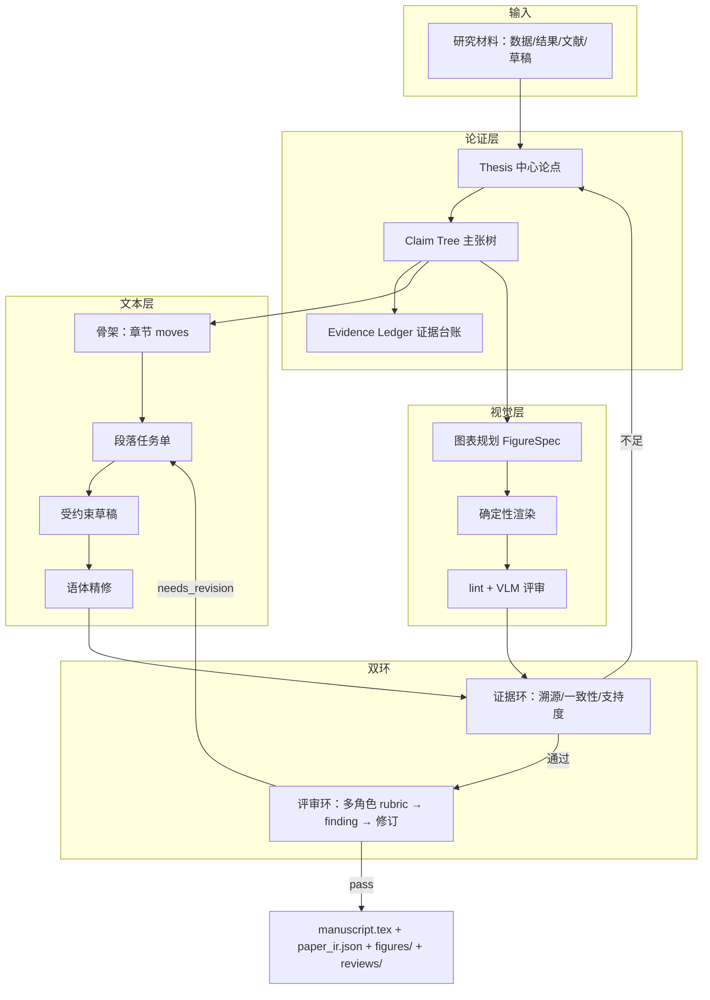

# 01 · 方案总纲

> 本文是任务一的主文档：先回答「AI 论文为什么差」，再给出可实施的方法与系统，最后给出「怎么证明它变好了」。
> 阅读顺序建议：第 1 章（诊断）→ 第 2 章（方法论）→ 第 3 章（系统）→ 第 4 章（模块规格，实现者看）→ 第 5 章（评测）。

---

## 1. 问题：为什么 AI 写的论文「读得下去，但立不住」

### 1.1 六个症状，一个病根

把任意一篇 AI 生成的论文和同主题的人写好论文放在一起，差异通常不在句子层面——单句往往通顺，甚至比人写得还「漂亮」。差异在**结构层**：

| # | 症状 | 具体表现 | 病根 |
|---|---|---|---|
| 1 | 全文没有推进 | 引言说「很重要」，方法说「我们提出」，实验说「效果更好」，结论说「未来可期」。四节各自成立，合起来没有论证。 | 没有唯一的、可证伪的中心论点 |
| 2 | 段落可随意删除 | 任意删掉一段，结论不受影响；段落之间是并列关系而非递进关系 | 段落没有论证任务，只有话题 |
| 3 | 结论大于证据 | 单数据集、单次实验，却写「显著优于现有方法」「证明了有效性」 | 缺限定词，措辞未与证据强度绑定 |
| 4 | 经不起核对 | 数字与表格对不上；引用文献不存在或与论断无关；实验设置描述含糊到无法复现 | 没有证据台账，数字是"写"出来的 |
| 5 | 一眼 AI 味 | 「随着……的不断发展」「值得注意的是」「不仅……而且……」；形容词三连；每段首句是套话；句长高度均匀 | 语体被当成风格模仿，而非证据强度的语法 |
| 6 | 图表是装饰 | 图在正文写完后"配"上去；图注只写"XX 的对比"；图表与正文互相不引用对方的结论 | 图不在论证链条里 |

### 1.2 根本原因：优化目标错了

主流论文生成系统的目标函数是「**给定材料，生成像论文的文本**」。这个目标的最优解是：

- 覆盖所有常见小节标题；
- 每段内部自洽、句子通顺；
- 用学术腔的词（"显著""框架""范式"）提高"像论文"的概率；
- 不冒险下强结论（因为强结论容易与材料冲突）。

**注意最后一条**：模型在规避风险时，会自动选择"正确的废话"。于是每句话都对，整篇文章没有信息量。这不是模型能力问题，是**目标错位**：它在优化"像不像"，而不是"成不成立"。

第二个原因是**缺少可校验的中间结构**。人类写论文时，脑子里有一张论证图（谁支持谁、哪里薄弱、哪里要限定）；模型没有这张图，只有上下文窗口。它只能靠局部连贯性"滑"过去，滑到哪算哪。

第三是**证据与文本脱钩**。模型生成数字的成本远低于查数字的成本，于是它倾向于生成。一旦数字是生成的，后面所有"分析"都是空中楼阁——实验部分的文字越流畅，问题越严重。

### 1.3 形式化：质量是乘法，不是加法

```
Q = A(论证必要性) × E(证据可核性) × S(语体合规性) × V(呈现有效性)
```

四项中任何一项趋近 0，整篇即失败：

- A=0：文章是资料汇编，读者读完不知道作者主张什么。
- E=0：结论不可信，越流畅越危险。
- S=0：读者在语体上就判定"非学术"，不再进入内容。
- V=0：图表误导或不可读，证据无法被检验。

AI 系统的通病是把乘法做成加法：每项 60 分，乘积 0.13。**提升路径不是"全面提升"，而是"先把任何一项从接近 0 拉到及格，再谈优化"。** 这就是本方案把大部分工程量放在"门禁"而不是"生成"上的原因。

### 1.4 已有系统的共性缺口

2024—2026 年的系统已经在往正确方向走，但都还留着同一个缺口：**"要求"写在提示词里，"契约"没有落到字段上**。

- **STORM / Co-STORM**（arXiv:2402.14207）解决了"写之前先研究和列提纲"，但对"提纲的每一节要证明什么"不作约束。
- **Agent Laboratory**（arXiv:2501.04227）、**PaperOrchestra**（arXiv:2604.05018）解决了端到端编排与文献综述质量，但正文仍是"按节生成"，段落级论证任务不显式。
- **Story2Proposal**（arXiv:2603.27065）引入了"契约状态"与"视觉契约"，是目前最接近本方案的思路；但它约束的是**结构一致性**（章节、图表是否缺漏），不是**主张与证据的对应关系**。
- **Spark-to-Paper**（arXiv:2608.11924）用确定性检查 + 自评把伪造检出率从 14% 提到 92%，并做到 99.5% 引用有效、96.4% 图可编辑——这证明"确定性检查优先"是对的；但它把检查放在生成之后，属"事后拦截"，本方案主张"事前约束 + 事中校验"。
- **CycleResearcher / CycleReviewer**（arXiv:2411.00816）证明评审信号可以反哺写作，但没有把评审意见映射回"哪个主张的证据不足"。

**结论：不要重造"多智能体写作框架"，要补三块契约——论证契约、语体契约、图表契约。** 详见 [02-文献与方法地图](02-文献与方法地图.md)。

---

## 2. 方法论：从「写文章」到「造论证」

### 2.1 一句话原则

> **先有可证伪的主张，再有必要的证据，最后才是句子。**
> 句子的合法性来自它兑现了哪个主张，而不是它写得有多好。

这条原则可以反向使用，作为最锋利的质量检查：**删掉一句话（或一段），如果没有任何主张失去支撑，它就该删。** 本方案的所有机制，本质都在让这句话可执行。

### 2.2 论证层：把 Toulmin 模型工程化

论文的最小论证单元不是"段落"，是"主张 + 依据 + 推论许可 + 限定"。Toulmin（1958）的六个要素，正好对位 AI 最常犯的六个错误：

| Toulmin 要素 | 在论文里的形态 | AI 的典型缺失 |
|---|---|---|
| **Claim（主张）** | 一句可证伪的断言 | 写成"研究了 X""探讨了 Y"，不可证伪 |
| **Grounds（依据）** | 数据、实验、引文、推导 | 有依据但与主张不匹配（用准确率证明效率） |
| **Warrant（推论许可）** | 为什么这些依据能推出这个主张 | **最常缺**。"A 方法在数据集 D 上提升 2%，因此 A 更优"——缺"D 能代表什么"的许可 |
| **Backing（支撑）** | 许可本身的依据（文献、理论、先验实验） | 常缺，导致 warrant 是断言而非论证 |
| **Qualifier（限定）** | 适用范围、置信度、条件 | 常缺，或与证据强度不匹配 |
| **Rebuttal（反驳）** | 反例、竞争解释、边界条件 | 常缺，或写成"未来工作"敷衍 |

**工程化要求：这六项必须成为 IR 里的字段，而不是提醒模型"注意论证"的一句话。** 一个 claim 如果没有 warrant 字段，系统就拒绝把它放进正文；一个 claim 如果有 rebuttal 字段但正文从未提及，评审环就报"未处理的反驳"。

#### 主张树（Claim Tree）规范

```
Thesis（1 条，全文唯一）
├── C1 子主张（支撑 thesis 的一个必要环节）
│   ├── P1.1 可检验命题（有证据）
│   └── P1.2 可检验命题（有证据）
├── C2 子主张
│   ├── P2.1 ...
│   └── P2.2 ...
└── C3 子主张（通常是"边界/代价/适用条件"，防止结论过大）
```

硬性规则（可直接写成校验器）：

1. **唯一根节点**：全文只能有一个 thesis。出现两个，说明作者没想清楚，退回。
2. **thesis 必须含四要素**：对象（在什么问题上）、干预（做了什么）、效应（发生了什么变化）、条件（在什么范围内成立）。缺一不可，缺了就是"正确的废话"。
3. **叶子必须绑定证据或标注为 argument**：`evidence` 型叶节点必须有 ≥1 条 evidence id；`argument` 型叶节点必须显式声明"由哪几条已证命题推出"。
4. **无孤儿**：不允许无证据的叶子主张进入正文；也不允许"有证据但没有任何主张使用它"（说明实验白做或论证断裂）。
5. **一段一任务**：每个段落只允许推进一个 claim_step，不允许一段里塞三个主张。
6. **限定随强度**：claim 的 `strength` 字段（strong/moderate/weak）决定正文允许的情态动词与副词，由语体检查器强制执行（见 2.3.4）。

#### 证据台账（Evidence Ledger）

每个 claim 的 grounds 指向一条证据记录，字段至少包含：

```json
{
  "id": "E-07",
  "type": "experiment",            // experiment | citation | dataset | derivation | observation
  "source": "results/main.json#/runs/3/metrics/f1",
  "metric": "macro-F1",
  "value": 0.842,
  "ci": [0.831, 0.853],
  "n": 5,
  "conditions": {"dataset": "FewRel-5shot", "seeds": 5, "baseline": "ProtoNet"},
  "strength": "moderate",          // 由规则计算，不由模型自评
  "scope": ["5-way 5-shot", "英文", "BERT-base 骨干"],
  "verified_by": "program",        // program | human | nli
  "verified_at": "2026-11-09T02:00:00Z"
}
```

**关键设计：`strength` 由规则计算，不由模型自评。**

```
strong   := 多数据集(≥2) ∧ 多 seed(≥3) ∧ 置信区间不跨 0 ∧ 有基线对照
moderate := 单数据集 ∧ 多 seed ∧ 有基线对照
weak     := 单次运行 ∨ 无基线 ∨ 仅案例观察
```

这条规则让"措辞"变成可计算的东西：`strength=moderate` 时，正文写 "demonstrates" 直接判错，必须改成 "suggests/indicates"。

### 2.3 文本层：三套语法 + 一份语体规格

#### 2.3.1 全文语法：IMRaD 之上还有 C-C-C

Mensh & Kording 的「Ten simple rules for structuring papers」（PLOS Comput Biol, 2017）给出两条对本方案最关键的规则：

- **一篇论文只有一个中心贡献**（one paper, one message）。所有小节都必须服务于它。
- **每个层级都用 Context → Content → Conclusion**：全文、每节、每段、甚至每句，都遵循"先给已知/背景 → 再给新信息 → 最后给结论/意义"。

这条 C-C-C 规则的价值在于：它天然定义了**段落的形状**——段首句是 topic sentence（承担 claim_step），段中是证据与推理，段尾句是"所以呢"（把证据兑现成主张推进）。AI 写的段落常常只有中间，缺头缺尾。

#### 2.3.2 引言语法：Swales CARS 模型

引言不是"背景介绍"，是**抢占研究空间**。Swales（1990）的 CARS（Create A Research Space）模型把引言拆成三个 move、若干 step，这是学术写作里被验证最多、最可直接教给模型的结构：

| Move | Step | 中文写作动作 | AI 常犯的错 |
|---|---|---|---|
| **M1 确立领域** | S1 声称重要性 | 用具体事实/数据说明问题重要，而非"随着……发展" | 空洞的宏大叙事 |
| | S2 综述已有研究 | 按**观点**分组，不按时间罗列 | 文献串烧："A 做了…B 做了…C 做了…" |
| | S3 指出已有研究的问题 | 落到**具体的**空白/矛盾/不可扩展处 | "仍存在不足"（不说是什么不足） |
| **M2 建立研究空间** | S1A 指出空白 | 明确"还没有人回答 X" | 空白与研究问题不对应 |
| | S1B 提出问题 | 把空白转成一个可回答的问题 | 问题太大或不可检验 |
| | S1C 延续传统 | 说明本文接续哪条线 | 缺，导致"凭空出现" |
| | S1D 转向新方向 | 说明为什么换路径 | 变成贬低他人工作 |
| **M3 占据研究空间** | S1 概述目标 | "本文主张……"（直接给 thesis） | "本文旨在探讨……"（无主张） |
| | S2 陈述主要发现 | 给出结论，不是"实验结果见第 4 节" | 藏结论，读者读完引言不知道结果 |
| | S3 说明结构 | 可选，且只在长文里用 | 机械的"第一节…第二节…" |

**可执行检查**：引言必须能标出 M1-S3、M2-S1A/S1B、M3-S1/S2 四处；缺任一处，评审环直接报"引言未建立研究空间"。

#### 2.3.3 段落语法：任务单（Paragraph Task Sheet）

这是本方案最核心的工程件。**不让模型"写一节"，让模型"填一张任务单"。**

一张任务单的字段：

```yaml
paragraph_id: P-3.2
claim_ref: C2/P2.1          # 推进哪个主张的哪一步
move: support               # propose | support | qualify | rebut | transition
topic_sentence: "在 5-way 1-shot 设定下，原型网络因类内方差大而退化。"   # 必须是断言，不是话题
evidence: [E-07, E-11]
reasoning: contrast         # deduction | induction | contrast | causal | analogy
reader_question: "为什么低资源会放大原型网络的偏差？"
exit_belief: "读者应相信：退化来自类内方差，而非原型数量不足。"
word_budget: 180
forbidden:
  - 引入新术语
  - 重复上一段已说的内容
  - 使用未定义的缩写
  - 出现无统计支撑的"显著"
```

> 说明：`claim_step` 不是一个独立字段，而是由 `claim_ref`（推进哪个主张）+ `move`（做哪一步）共同确定。任何一段都必须能回答"你在替谁说话、说到哪一步"。

任务单解决了三个问题：

1. **防止并列**：`move` 只有五种，且同一节里的 move 必须递进（propose → support → qualify），不能连续三个 support 说同一件事。
2. **防止冗余**：`exit_belief` 是唯一验收标准。写完对照：读者读完这一段，是否真的获得了这个信念？没有就重写，而不是"再润色一下"。
3. **防止跑题**：`forbidden` 是硬约束，语体检查器可以直接查（新术语表、上段关键词重复率、缩写表、"sig" 词）。

#### 2.3.4 语体：不是"风格模仿"，是"证据强度的语法"

学术语体的本质不是"用大词"，而是**用语法精确编码 epistemic status（认知状态）**：我知道多少、我有多确定、这个结论能推多远。Hyland（2005）的元话语框架把这件事拆得很清楚：

| 元话语类型 | 功能 | 例子 | AI 的问题 |
|---|---|---|---|
| **模糊限制语 Hedge** | 降低承诺，留出余地 | may, suggest, appear to, 似乎, 可能 | 过少（结论过强）或过多（什么都没说） |
| **增强语 Booster** | 提高承诺 | demonstrate, clearly, 表明, 充分说明 | 过多且与证据不匹配 |
| **态度标记 Attitude** | 表达评价 | surprisingly, importantly, 值得注意的是 | 泛滥成套话 |
| **自我提及 Self-mention** | 作者立场 | we, 本文, 本研究 | 中英不一致，或滥用"我们" |
| **介入标记 Engagement** | 拉读者 | consider, note that, 试想 | 几乎没有 |

**核心机制：hedge/boost 必须与 `claim.strength` 绑定，由检查器强制。**

| 证据强度 | 英文允许 | 英文禁止 | 中文允许 | 中文禁止 |
|---|---|---|---|---|
| **strong** | demonstrate, establish, show that, consistently | may, might, possibly | 表明、证明、一致地显示 | 可能、或许、似乎 |
| **moderate** | indicate, suggest, is consistent with, we observe | prove, demonstrate, establish | 提示、说明、与……一致、观察到 | 证明、充分表明 |
| **weak** | appear to, preliminary evidence, we conjecture | 任何因果/普适断言 | 初步看来、似乎、我们推测 | 任何因果/普适断言 |

这条规则一上，AI 论文最刺眼的"单数据集却写 demonstrates"就会被自动拦下。它比"请使用学术语言"这种提示词有效一个数量级，因为它是**可判定的**。

#### 2.3.5 去 AI 味：黑名单 + 改写模式

"AI 味"不是玄学，是一组可枚举的模式。下面这张表可以直接做成检查器：

| 模式 | 例子 | 为什么是 AI 味 | 改写方向 |
|---|---|---|---|
| 宏大开场 | 「随着人工智能技术的不断发展……」 | 零信息量，任何人任何题目都能用 | 删；或换成具体事实/数据 |
| 元话语套话 | 「值得注意的是」「综上所述」「总而言之」 | 不承载信息，只是节奏填充 | 删；直接给结论 |
| 三连排比 | 「高效、准确、鲁棒」 | 形容词堆叠替代论证 | 删到 1 个，或换成量化指标 |
| 空洞强调 | 「极大地提升了性能」 | 无统计、无基线、无数值 | 换成"在 X 上提升 Y（95% CI …）" |
| 伪递进 | 「不仅……而且……」连用 | 形式递进，内容并列 | 合并为一句，只保留信息量大的 |
| 句型均匀 | 每句 25—30 字，结构相似 | 人类写作句长方差大 | 强制句长方差下限（见评分卡） |
| 首句套话 | 「在本节中，我们将介绍……」 | 不承担 topic sentence 功能 | 首句必须是断言 |
| 过度名词化 | 「对模型性能的提升的实现」 | 中文尤其明显，"的"字链 | 拆成动词句 |

**注意：黑名单是下界，不是上界。** 只做"删套话"会把文章删成骨架；真正提升语体的是 2.3.3 的任务单（保证每段有信息）与 2.3.4 的强度对齐（保证措辞精确）。顺序不能反。

#### 2.3.6 中英差异（必须分轨）

| 维度 | 英文论文 | 中文论文 |
|---|---|---|
| 主张句式 | "We show that X…" 主动、短 | "结果表明，X……" 常用无主句/"本文" |
| 名词化 | 高，但动词句仍是骨架 | 更高，易出现"的的不休"，需主动拆句 |
| 连接词 | however / moreover / in contrast | 然而/此外/相比之下，但忌每段都用"首先/其次/最后" |
| 时态 | 方法/结果过去时，讨论现在时 | 无时态，靠"了/已/将"与时间副词 |
| 自称 | we 普遍（单作者也用 we） | 本文/本研究为主，"我们"视期刊而定 |
| 数字 | 千分位、单位空格 | 阿拉伯数字、单位紧跟、范围用"~"或"–" |
| 图表题注 | 图下、表上 | 图下、表上（GB/T 7713.1 学位论文常用） |
| 参考文献 | APA/IEEE/ACM | GB/T 7714—2015 |

评分卡对中英分别给规则，不能用一套阈值。

### 2.4 视觉层：图表是「可视化的断言」

#### 2.4.1 第一原则：图不是插画，是断言

Rougier 等人的「Ten Simple Rules for Better Figures」（PLOS Comput Biol, 2014）里，最要紧的是前两条：

- **Rule 1: Know your audience** —— 图是给谁看的，决定信息密度。
- **Rule 2: Identify your message** —— 先想清楚这张图要传达的**那一句话**，再动手设计。

把这两条翻译成工程约束：

> **一张图 = 一条断言。图注的第一句必须是这条断言本身，而不是"XX 的对比"。**

对比：

- ❌ 「图 3：不同方法在 FewRel 上的准确率对比。」（描述，不是断言）
- ✅ 「图 3：在 5-way 1-shot 设定下，类内方差是原型网络退化的主因；方差归一化后差距从 9.2 个点缩小到 2.1 个点。」（断言，读者不读正文也知道结论）

后者同时满足三个要求：它对应一个 claim（C2/P2.1）、它指明读者该看哪里（差距从 9.2 → 2.1）、它自带限定（5-way 1-shot）。

#### 2.4.2 图与论证的对应关系

```
Thesis
  └── C2（方差是主因）
        └── P2.1（归一化后方差下降、差距缩小）
              ├── 图 3a：方差随 shot 数变化（机制证据）
              ├── 图 3b：归一化前后差距（效应证据）
              └── 表 2：完整数值与置信区间（可核对）
```

三条硬规则：

1. **一图一 claim**：图如果同时想证明"更准"和"更快"，拆成两个 panel，各自服务一个子主张；如果拆不开，说明作者没想清楚。
2. **图序 = 论证序**：读者按 Fig.1 → Fig.2 → Fig.3 读下来，应该刚好走完论证链。图序乱 = 论证乱。
3. **图表必须被正文"引用结论"，而不只是"引用编号"**：正文写"如图 3 所示"是无效引用；有效引用是"图 3 显示，归一化后方差下降 62%，差距缩小到 2.1 个点"——即正文复述了图的断言。

#### 2.4.3 关系 → 编码：先定"要证明什么关系"，再选图型

图型不是审美选择，是**数据关系的函数**。这张表可以直接做成规划器的查表规则：

| 要证明的关系 | 首选编码 | 避免 | 理由 |
|---|---|---|---|
| 两组/多组比较 | 点图（dot plot）、条形图（从 0 起） | 饼图、3D 柱 | 位置编码比角度/面积更易读 |
| 随某一连续量的趋势 | 折线图（≤4 条线）、带 CI 的带 | 多条线堆叠、双 y 轴 | 双轴会伪造相关性 |
| 分布差异 | 小提琴/箱线 + 散点（strip） | 只画均值柱 | 均值掩盖方差，而方差常是论点 |
| 相关性 | 散点 + 拟合线 + CI | 只给相关系数 | 关系形状（非线性/异方差）是信息 |
| 构成/占比 | 堆叠条（少量类别）、直接标数 | 饼图、环形图 | 角度判断精度差 |
| 多因素交互 | 热力图、分面小图（small multiples） | 一张图塞 10 条线 | 分面让比较变成"同位置对比" |
| 消融/敏感性 | 排序点图、斜坡图 | 未排序的柱状 | 排序本身是结论 |
| 方法/机制 | 节点-边图（分层布局） | 手绘风插图 | 结构要可核验、可编辑 |
| 不确定性 | 误差棒/CI 带/样本量标注 | 只画点估计 | 不画不确定性等于隐藏证据强度 |

#### 2.4.4 设计规则（可 lint 的部分）

从 Ten Simple Rules、Tufte 的数据墨水比、以及主流期刊图件规范里，提炼出**机器可查**的规则：

| 类别 | 规则 | 检查方式 |
|---|---|---|
| 尺寸 | 单栏 89 mm / 双栏 183 mm（按目标期刊配置） | 读 PDF 页面框 |
| 字号 | 最终尺寸下 ≥ 5–7 pt；面板标签 8 pt 粗体 | 提取 PDF 字体大小 |
| 颜色 | 定性用色盲安全调色板（Okabe-Ito）；顺序用 viridis 类；发散用冷暖双极 | 检查 palette id + 色差 ΔE |
| 轴 | 条形图 y 轴从 0；不得截断 | 读轴范围 |
| 误导 | 禁止双 y 轴、3D、饼图比较、面积编码半径 | 读 spec 的 chart type 与 encoding |
| 冗余 | 无网格线或极淡；无背景色块（除非有语义）；无图例时直接标注 | 检查 style token |
| 可读 | 标签不重叠、不溢出画布、不被裁切 | 渲染后检测 bbox 相交 |
| 自足 | 图注含：画的是什么、怎么读、结论是什么、n 与误差含义 | LLM + 规则（关键词/数字） |

**注意最后一条**：图注自足性是最容易被忽略、又最能体现"专业度"的细节。审稿人读图 30 秒，读不懂就扣分。

#### 2.4.5 表与图的分工：表用于核对，图用于理解

2025 年的一项多模态评测（"Format Matters", AAAI 2026, arXiv:2511.10075）发现：多模态模型核验科学主张时，**读表格明显强于读图表**，而人类在两种格式上都很稳。这个发现有两个工程含义：

1. **凡是要被核对的精确结论，必须同时以表给出**（数值、CI、n）。图负责让人"看懂模式"，表负责让人"核对数字"。
2. **自动核验优先基于表**：证据环在检查"正文数字是否与结果一致"时，应读结构化表/JSON，而不是读图。

表格规范（可直接 lint）：三线表（无竖线）、单位写在表头、小数点对齐、小数位一致、显著性标记有说明、n 与误差类型注明、避免在表里放图。

#### 2.4.6 FigureSpec：让图变成可校验的中间件

不要直接让模型输出绘图代码，也不要让它输出图片。让它输出**规格**：

```json
{
  "id": "fig3",
  "claim_ref": "C2/P2.1",
  "assertion": "类内方差是低资源退化的主因；归一化后差距从 9.2 降至 2.1 个点",
  "audience": "同领域审稿人",
  "panels": [
    {
      "label": "a",
      "sub_assertion": "方差随 shot 数减少而上升，且在 1-shot 处最高",
      "data_ref": "results/variance.json#/by_shot",
      "relation": "trend",
      "encoding": {"type": "line", "x": "shot", "y": "within_class_var", "color": "backbone"},
      "annotation": {"text": "1-shot 处方差最大", "at": [1, 0.42]}
    },
    {
      "label": "b",
      "sub_assertion": "归一化后方法差距收窄",
      "data_ref": "results/main.json#/runs",
      "relation": "comparison",
      "encoding": {"type": "dot", "x": "method", "y": "f1", "yerr": "ci95", "baseline_zero": false},
      "annotation": {"text": "差距 9.2 → 2.1", "at": ["vanilla", 0.71]}
    }
  ],
  "style": {"palette": "okabe-ito", "font_pt": 7, "width_mm": 89, "panel_label": "bold-8pt"},
  "caption": {
    "what": "5-way k-shot 下类内方差与归一化效应",
    "how": "点图误差棒为 5 个 seed 的 95% CI",
    "takeaway": "方差是主因；归一化后差距收窄至 2.1 个点"
  }
}
```

这份 spec 同时是：规划产物、渲染输入、评审对象、以及**正文与图一致性的校验依据**（正文写了图 3 的结论，检查器比对 `assertion` 与正文句子）。

---

## 3. 系统：ArgFirst 的三层两环

### 3.1 总览



**产物即状态。** 系统不保存"对话记忆"作为真相，真相在四类文件里：

```
project/
├── paper_ir.json          # 论证层唯一真相：thesis / claims / evidence / sections / paragraphs / figures
├── results/               # 实验与数据产物（只读输入）
├── figures/
│   ├── spec/fig3.json     # 图表规格
│   └── render/fig3.pdf    # 渲染结果
├── manuscript/main.tex    # 由 IR 渲染 + 人工编辑
├── checks/                # 每次检查的报告（可 diff）
└── reviews/               # 评审意见与修订记录
```

这样做的好处：可 diff、可回滚、可审计、可被任务二的平台直接读写、可以被 git 管理。

### 3.2 数据契约：PaperIR 的六张表

| 表 | 关键字段 | 谁写 | 谁能改 |
|---|---|---|---|
| `thesis` | statement, scope, falsifier | 人（AI 起草） | 人 |
| `claims[]` | id, parent, statement, warrant, qualifier, rebuttal, strength, evidence_refs, status | AI 起草 + 人确认 | 人 |
| `evidence[]` | id, type, source, metric, value, ci, n, conditions, strength, scope | 程序（从 results 抽取） | 程序 |
| `sections[]` | id, move, purpose, paragraph_ids, word_budget | AI | 人 |
| `paragraphs[]` | id, claim_ref, move, topic_sentence, evidence, word_budget, status, draft | AI | 人 |
| `figures[]` | id, claim_ref, assertion, panels, style, caption, render{path, lint} | AI 起草 spec | 人 |

完整 schema 见 [spec/paper_ir.schema.json](../spec/paper_ir.schema.json)。

**关键约束：人改 IR，机器改正文；机器不得在正文里"顺手"引入 IR 之外的主张。** 这条约束是全文一致性的根。如果机器认为需要新主张，它必须提交一个 `ir_patch` 建议，由人确认后才生效。

### 3.3 五个阶段与门禁

| 阶段 | 输入 | 产物 | 出口门禁（不过则退回） |
|---|---|---|---|
| **① 立骨** | 题目、材料、初步结果 | thesis + claim tree + evidence ledger | thesis 四要素齐全；无孤儿主张；每个叶子有证据或 argument 声明 |
| **② 搭架** | IR | sections（moves）+ 段落任务单 | 引言四检查点齐全；每段有唯一 claim_step 与 exit_belief；字数预算合计与目标篇幅误差 <10% |
| **③ 行文** | 任务单 + 证据 | 段落草稿 | 每段兑现 exit_belief；无禁用内容；数字全部来自 evidence source |
| **④ 成图** | claims + results | FigureSpec + 渲染图 + 图注 | spec 与 claim 对应；lint 全过；VLM 评审 ≥ 阈值；图注含 takeaway |
| **⑤ 过审** | 全文 + 图 + IR | 评审报告 + 修订稿 | 一票否决项为零；六维评分 ≥ 阈值；所有 high/blocker finding 已关闭 |

### 3.4 双环：证据环与评审环

**证据环（Grounding Loop）——回答"这句话凭什么"**

对正文的每一个断言句，做三件事：

1. **溯源**：句中出现数字/比较/因果，必须能解析到 evidence id。解析不到 → blocker。
2. **一致性**：句中数字与 evidence 的 value 完全一致（容差按量纲配置）；比较方向一致（"高于"不能对应负 delta）。
3. **支持度**：对引文型断言，取原文摘要/段落，用 NLI 判定"原文是否支持该句"。阈值以下 → 要求降级措辞或删句。

这一步对应 Spark-to-Paper 的"确定性检查 + 自评"组合，也是把伪造检出率从 14% 拉到 92% 的关键。

**评审环（Critique Loop）——回答"这篇能不能过"**

四个角色，各自带 rubric，输出**可定位、可执行**的 finding：

| 角色 | 关注 | 输出示例 |
|---|---|---|
| 贡献审稿人 | thesis 是否新、是否被兑现 | `{"claim":"C2","problem":"P2.1 只在一个数据集验证，但正文称'一致地'","fix":"降级为 suggests 或补数据集"}` |
| 方法审稿人 | warrant 是否成立、基线是否公平 | `{"paragraph":"P-3.4","problem":"缺少与 ProtoNet 同骨干的对照","fix":"补 run 或限定结论"}` |
| 实验审稿人 | 证据强度、统计、可复现 | `{"evidence":"E-07","problem":"n=1，无 CI","fix":"补 seed 或标 weak"}` |
| 写作/图表审稿人 | 语体、结构、图注、误导 | `{"figure":"fig3","problem":"y 轴未从 0 起且为条形图","fix":"改点图"}` |

**finding 必须是 (定位, 问题, 修法) 三元组**，否则无法自动修订。这也是 ARISE 那类 rubric 迭代能起作用的前提——评审意见要"behaviourally anchored"（行为锚定），不能是"写得不够好"。

### 3.5 关键取舍（以及为什么）

| 取舍 | 选择 | 理由 | 代价 |
|---|---|---|---|
| 端到端一次生成 vs 结构化流水线 | 结构化 | 端到端无法定位失败环节，也无法保证一致性 | 工程复杂度高，需要 IR |
| 图像生成 vs 代码渲染 | 代码渲染 | 图要可核验、可编辑、可复现；图像模型会伪造坐标轴与数字 | 视觉表现力受限于绘图库 |
| LLM 评审 vs 确定性检查 | 确定性优先 | LLM 评审会放过伪造主张（MLReplicate: 59%） | 需要为每类问题写规则 |
| 自由写作 vs 任务单约束 | 任务单 | 自由写作必然产生并列段落与冗余 | 初期"写不快"，但返工少 |
| 单一通用提示词 vs 分阶段提示词 | 分阶段 | 每个阶段的失败模式不同，约束必须不同 | 提示词资产需要维护 |
| 主张强度自评 vs 规则计算 | 规则计算 | 模型系统性高估自己的证据 | 规则需要按学科调参 |

---

## 4. 模块规格（可实施）

> 每节给出：输入 / 输出 / 算法要点 / 失败模式 / 验收标准。提示词见 `prompts/`。

### M1 论证内核构建器（立骨）

**输入**：题目、研究问题、已有结果（可选）、关键文献（可选）
**输出**：`thesis` + `claims[]` + `evidence[]` 草案

**算法**：

1. 生成 3 个候选 thesis，按"可证伪性"打分（能否设想一个实验推翻它）；
2. 由人选一个，强制补全四要素（对象/干预/效应/条件），缺项追问，不允许"待定"；
3. 递归分解：thesis → 2–4 个子主张（每个是必要环节，不是并列话题）；子主张 → 1–3 个可检验命题；
4. 对每个叶子，要求给出：证据类型、若证据为 X 则支持/若为 Y 则推翻（预注册式思维）；
5. 计算 strength，检查"主张强度 ≤ 证据强度"。

**失败模式**：thesis 太大（"提升大模型能力"）；子主张是话题而非断言（"研究低资源问题"）；叶子无证据且无法标 argument。
**验收**：任意一个叶子主张，能在 30 秒内说出"什么结果会推翻它"；说不出来 → 退回。

### M2 骨架编译器（搭架）

**输入**：IR
**输出**：`sections[]` + `paragraphs[]`（任务单）

**算法**：

1. 按论文类型选模板（实证/综述/系统/理论），模板只定义 move 序列，不定义内容；
2. 引言按 CARS 生成 move/step 序列，每步一个段落任务单；
3. 相关工作按**观点分组**（不是按论文罗列），每组一个任务单，`move=contrast`；
4. 方法按"问题 → 设计约束 → 机制 → 为何满足约束"生成，禁止"我们使用了 X"式流水账；
5. 实验按 claim 逐条生成（不是按实验逐条），每条 claim 对应"设置 → 结果 → 解释 → 限定"；
6. 为每段分配字数预算，合计与目标篇幅对齐。

**失败模式**：方法与实验节出现"话题段落"（没有 claim_ref）；相关工作变成文献串烧。
**验收**：把任务单按顺序读一遍，能复述出完整论证；读不出 → 结构有问题。

### M3 段落写手（行文）

**输入**：任务单 + 证据 + 前后段摘要 + 语体规格
**输出**：段落草稿 + 自评（是否兑现 exit_belief）

**算法要点**：

1. **先写 topic sentence，再写其余**：首句必须是断言，且必须包含 claim 的关键词；
2. **证据句必须带定位**：数字来自 evidence，比较对象显式；
3. **段尾句必须"所以呢"**：把证据兑现成主张推进，不能是"综上所述"；
4. **禁止事项硬编码**：新术语、未定义缩写、重复上段、无统计的"显著"；
5. **长度硬约束**：超出预算 ±20% 直接重写（不是截断）。

**失败模式**：写成"总-分-总"的说明文；证据句变成"实验表明"（不说是哪个实验）；段尾重复 topic sentence。
**验收**：`exit_belief` 抽样人评 ≥ 80% 认为"读完确实相信了"。

### M4 语体精修器（精修）

**输入**：段落草稿 + claim strength + 语体规格
**输出**：修订稿 + diff + 指标报告

**算法**：

1. 规则层（必须全过）：hedge/boost 与 strength 对齐；黑名单；句长方差；术语一致；数字格式；
2. 模型层（建议）：重写过度名词化的句子、拆分"的的不休"、把被动改主动（英文按学科惯例）；
3. **只允许做"减法与替换"，不允许新增主张**：任何新增信息必须带 evidence 引用，否则拒绝；
4. 输出 diff，人可逐条接受/拒绝。

**失败模式**：改写成另一种套话；为了"学术化"堆砌术语；删掉了限定条件。
**验收**：修改前后指标对比表（见评分卡），且人评"信息量未减少"。

### M5 图表规划器（成图第一步）

**输入**：claims + evidence + results
**输出**：`figures[]` 的 FigureSpec（含 assertion、panel、encoding、annotation、caption）

**算法**：

1. 从 claims 里筛"需要视觉证据"的（比较、趋势、分布、机制），一个 claim 最多一张主图；
2. 对每个 claim 问三个问题：读者要相信什么？哪个对比/趋势能证明它？看哪里能一眼看出？
3. 按 2.4.3 的关系→编码表选图型（规则查表，不让模型自由发挥）；
4. 生成 caption 三段式（what/how/takeaway），takeaway 必须与 claim statement 语义一致（用相似度校验）；
5. 若数据不支持该图（样本太少、无 CI），降级为表，或要求补实验。

**失败模式**：一张图塞三个结论；图型与关系不匹配（用饼图做比较）；caption 只描述不结论。
**验收**：把 caption 单独拿出来读，能独立成立；且与 claim 对得上。

### M6 渲染与评审（成图第二步）

**输入**：FigureSpec + 数据
**输出**：PDF/SVG + lint 报告 + VLM 评审 + 修订

**算法**：

1. **先规划后写码**（SciFigure2Code 的结论：plan-then-code 对所有被测模型都有效）；
2. 渲染器按 spec 生成代码（matplotlib/TikZ/Graphviz/ELK），布局交给引擎，模型不碰坐标；
3. **确定性 lint**：字号、边距、溢出、重叠、色板、轴起点、图例遮挡、分辨率；
4. **VLM 评审**：可读性、误导性、信息密度、是否支持 assertion；
5. **局部修补而非重画**（EdiTikZ 的结论：编辑轨迹比从零生成更可靠）——finding 定位到 panel/元素，只改那一处；
6. 通过后冻结，写入 `figures/render/`，并在 IR 里登记 hash。

**失败模式**：每次重画导致风格漂移；lint 过了但语义错（图不支持 caption）。
**验收**：lint 100% 通过；VLM 评审 ≥ 4/5；人工抽检"图是否真的支持 caption" ≥ 90%。

### M7 证据环

**输入**：正文 + IR + results + 引文库
**输出**：`checks/grounding.json`（逐句）

**算法**：

1. 分句 → 分类（事实/比较/因果/评价/方法描述）；
2. 抽取数字与实体 → 对齐 evidence；
3. 引文断言 → 取原文证据段 → NLI 三分类（支持/中立/矛盾）；
4. 汇总为 blocker / major / minor；
5. 自动修复建议（降级措辞/补引用/删句），但**不自动删主张**——删主张必须人确认。

**失败模式**：把"方法描述句"误判为"事实断言"导致大量误报；NLI 对长句不稳定。
**验收**：伪造数字检出率 ≥ 95%，误报率 ≤ 10%（用人工标注集校准）。

### M8 评审环

**输入**：全文 + IR + 图 + 评分卡
**输出**：`reviews/round-N.json` + 修订任务

**算法**：

1. 四个角色独立评分（不看彼此结论，避免锚定）；
2. 每人输出 finding 三元组，映射到 claim/paragraph/figure id；
3. 聚合：同一位置 ≥2 人提出的升为 major；涉及伪造/矛盾的升为 blocker；
4. 生成修订任务，按"影响面 × 严重度"排序；
5. 修订后复评，只复评受影响的条目 + 全局一致性；
6. 收敛判据：连续两轮无新 blocker，且分数提升 < 1 分 → 停；或达到轮次上限升级人工。

**失败模式**：评审意见互相矛盾；模型"自我感觉良好"；无限循环。
**验收**：与人工评审的相关性（Spearman）≥ 0.6；单轮修订关闭率 ≥ 70%。

---

## 5. 评测：怎么证明它真的更好

### 5.1 指标树

| 层 | 指标 | 定义 | 目标 |
|---|---|---|---|
| **论证** | 主张覆盖率 | 有段落兑现的 claim 数 / claim 总数 | ≥ 95% |
| | 论证必要性 | 删掉任一段后，是否有 claim 失去支撑（人工抽样） | ≥ 90% 段落"不可删" |
| | warrant 完整率 | 含显式推论许可的 claim 比例 | ≥ 90% |
| **证据** | 数字可溯率 | 正文数字能对上 results 的比例 | 100% |
| | 引用有效率 | DOI/arXiv 可解析且支持该句的比例 | ≥ 95% |
| | 伪造检出率 | 注入伪造后被抓出的比例 | ≥ 95% |
| **语体** | 强度对齐率 | hedge/boost 与 strength 一致的比例 | ≥ 95% |
| | 套话密度 | 黑名单命中数 / 千字 | ≤ 2 |
| | 句长方差 | 段落内句长标准差 | ≥ 6（中）/ ≥ 5（英） |
| **呈现** | 图-claim 对应率 | 每图有且仅有一个 claim_ref | 100% |
| | lint 通过率 | 首次渲染通过 lint 的比例 | ≥ 80% |
| | 图注自足率 | 含 what/how/takeaway 的比例 | 100% |
| **综合** | 盲评胜率 | 与基线成对盲评，人偏好本方案的比例 | ≥ 65% |
| | 评审分 | 六维评分卡均分 | ≥ 80/100 |

### 5.2 基准与对照

- **外部基准**：PaperBench（复现能力）、PaperWritingBench（从原始材料写作）、WritingBench（通用写作质量）。用它们的任务与评分卡，但**报告时要说明 judge 的可靠性**。
- **对照**：① 直接提示（DirectChat）；② 单 agent 按节生成；③ 有骨架无 IR；④ 有 IR 无证据环；⑤ 全量。
- **关键**：必须做**消融**，否则无法回答"到底是哪一部分在起作用"。建议消融顺序：FigureSpec → 语体规格 → 任务单 → 证据环。

### 5.3 人工评测协议

- 盲评：隐藏来源，随机顺序，至少 3 名同领域评审；
- 维度：论证可信度、证据充分性、语体专业度、图表质量、整体可发表性（1–7 Likert）；
- 成对偏好 + 理由（自由文本），理由用于发现 rubric 未覆盖的问题；
- 一致性：报告 Krippendorff's α；α < 0.5 时不得下强结论。

### 5.4 已知陷阱

1. **LLM judge 不可信**：MLReplicate 发现被自动评审接收的稿件中 59% 含编造或无支撑断言。→ judge 只做筛查，blocker 必须人工或确定性检查。
2. **指标 gaming**：模型会学会"堆 hedge 通过检查"（变得什么都没说）或"每句都引用"（引用泛滥）。→ 指标必须成对设计（如 hedge 合规率 + 信息密度）。
3. **基线太弱**：与"直接提示"比赢了没有意义。→ 必须比 Story2Proposal/Spark-to-Paper 这类强基线。
4. **领域漂移**：在 ML 论文上调好的阈值，换到医学/人文会失效。→ 阈值按学科配置，先做 2–3 个学科，不要一开始铺开。

---

## 6. 风险、边界与伦理

| 风险 | 表现 | 对策 |
|---|---|---|
| 过度约束 → 模板化 | 所有论文长得一样，段落变成填表 | 约束"信息结构"而非"句式"；每节允许一个"自由段"用于真正的创造性表达 |
| 语体检查误伤 | 合理的长句、必要的被动被罚 | 规则分"硬/软"两级，软规则只提示不阻断 |
| 证据环误报 | 方法描述被当成事实断言 | 先分句分类，再检查；误报率纳入验收 |
| 学科差异 | 人文论文没有"实验"，工科论文图多 | 模板与 rubric 按学科配置；论证层通用 |
| 成本 | 每篇多轮生成 + 渲染 + 评审 | 分阶段缓存；只对"被标记"的段落重跑；图表用廉价模型 + 确定性渲染 |
| 伦理 | 代写、伪造、署名 | 强制披露 AI 参与；系统拒绝对无来源数据"美化"；主张强度只能降不能升 |

**一条不可妥协的原则**：当证据不足时，系统的正确行为是**降低主张强度或删除主张**，而不是写一段更漂亮的过渡把它糊过去。这条原则要写进系统提示词、写进评审 rubric、写进产品文案。

---

## 7. 与任务二的接口

任务二的平台不是"聊天框 + 导出"，而是**围绕 IR 的四个工作台**：

1. **论证台**：可拖拽的 claim tree，节点显示 strength/evidence 数/未关闭 finding；
2. **骨架台**：章节 moves 与段落任务单，支持"这段没有任务"的红色告警；
3. **正文台**：左侧 IR、中间正文、右侧 checks（实时显示哪句没溯源）；
4. **图表台**：spec 编辑 + 渲染预览 + lint 报告 + VLM 意见，一键应用修补。

状态机：`draft → grounded → styled → figured → reviewed → accepted`，每次跃迁都要过对应门禁。平台的价值不在"生成得快"，而在**让失败可见、可定位、可修**。

---

## 附：本方案的"最小可行版本"（两周可跑）

如果只做一件事，做这个：

1. 手写 `paper_ir.json`（10 个 claim 以内）；
2. 用 `prompts/p2-搭架.md` 生成任务单；
3. 用 `prompts/p3-行文.md` 逐段生成；
4. 用 `docs/03-质量评分卡.md` 人工打分；
5. 用 `prompts/p5-成图.md` 生成 3 张图的 spec，手工渲染。

跑通一遍，你会得到两个东西：一套可复用的提示词资产，以及**对"哪里最容易崩"的真实体感**——后者决定任务二先做哪个工作台。
