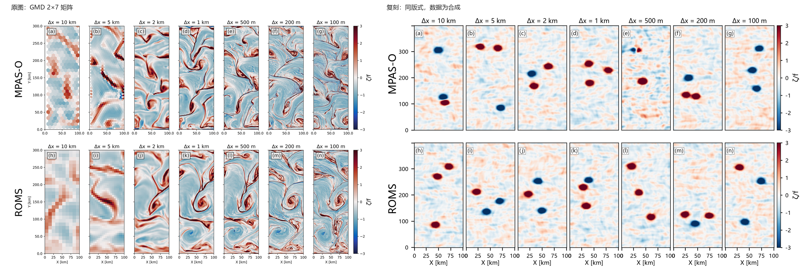
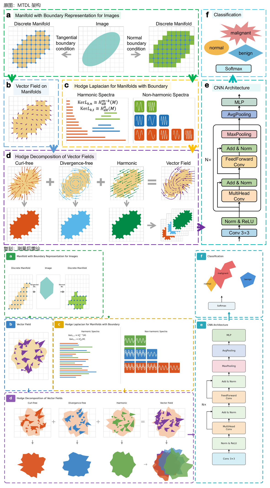

# 22 图表复刻：从示例图到可重跑规格

> 你说得对：分类只回答"这是什么"，复刻才回答"能不能做出来"。
> 复刻是模板库的验收标准——**每个模板至少要能复刻一张真实图，否则只是纸上分类。**
>
> 这一版先定方法，再用 GMD 的 2×7 矩阵图做第一张复刻。

---

## 0 复刻的三层

| 层级 | 要求 | 数据 | 适用 |
|---|---|---|---|
| **L1 版式复刻** | 面板数、网格、比例、共享色标/轴、标签、字母、箭头一致 | 可合成 | 所有图 |
| **L2 数据复刻** | 数值与图一致，曲线/地图能对上 | 必须有源数据 | 自己论文、带表格的图 |
| **L3 矢量复刻** | 输出 PDF，文字/框可编辑，能改 | 同 L1/L2 | 架构图、流程图 |

**不能把 L1 冒充 L2。** 没有源数据时，图注必须写"结构复刻，数据为示意"。

---

## 1 复刻什么：看结构，不看像素

一张图拆成六层，逐层对齐：

1. **画布**：宽高比、单双栏、留白；
2. **网格**：几行几列、面板宽高比、间距；
3. **共享元素**：色标（位置/范围/刻度）、轴（范围/刻度/方向）、行标签/列标题；
4. **图元**：框、箭头、虚线容器、ROI 框、放大引线；
5. **文字**：图名、轴标题、面板字母、统计标注、单位；
6. **图注**：断言、读法、边界。

像素级相似不是目标；**结构和语义对齐**才是。

---

## 2 复刻流程（七步）

```
1 选图    从语料里挑代表：矩阵 / 地图复合 / 架构 / 定性网格
2 测量    面板数、网格比例、色标位置、字号层级、轴范围
3 写 spec repro/FIGx.json：canvas / panels / shared / annotations
4 造数据  有源数据用源数据；没有就合成，并在图注标注
5 渲染    面板渲染器（figspec/archspec/专用）+ 画布组合
6 对比    并排图 + 结构指标（面板数、位置、文字、色标范围）
7 固化    复刻成功的版式沉淀成模板，并加入回归集
```

第 2 步最容易被低估：**测量错了，后面全错**。目前先人工测量；后续再接 VLM/OCR 辅助。

---

## 3 验收标准

| 项 | 通过条件 |
|---|---|
| 面板数/网格 | 与原图一致 |
| 共享元素 | 色标范围、轴方向、行列标签位置一致 |
| 文字 | 图名、轴标题、面板字母齐全；关键统计标注在 |
| 视觉 | 并排看 10 秒，能认出是同一类图 |
| 数据 | L1 标注"示意"；L2 数值误差在可接受范围 |
| 输出 | PDF/SVG 可编辑，PNG ≥300 dpi |

不追求 SSIM 高分；追求"结构对、读法对、能改"。

---

## 4 第一张：GMD 2×7 矩阵

- 原图：`corpus/figures/field2/gmd-10321-2026-2.png`（2 行 × 7 列，行=模型，列=分辨率）；
- 复刻：`figures/repro/GMD_matrix.png`；
- 并排：`figures/repro/compare.png`；
- 代码：`tools/repro_matrix.py`，规格在 `figures/repro/matrix.json`。



**对上的**：2×7 网格、行标签（MPAS-O / ROMS）、列标题（Δx）、(a)—(n) 字母、每行一个色标、
坐标范围与方向、底部 X 轴刻度。

**没对上的**：数据是合成的，涡度场比原图平滑；这是 L1 复刻，图注必须注明"数据为示意"。

**学到什么**：

- 矩阵图的难点不是画场，是**共享元素只画一次**：列标题只在顶行、Y 刻度只在左列、色标每行一个；
- 色标要和面板同高，不能比面板高；
- 面板宽高比由数据域决定（原图 100×300），不能随手设成正方形。

---

## 4.2 第二张：SAM overview

- 原图：`corpus/figures/arch/arxiv/2304.02643-f10.png`（arXiv:2304.02643 Fig. 4）；
- 复刻：`figures/repro/SAM_overview.png`（PDF/SVG 也有）；
- 并排：`figures/repro/SAM_compare.png`；
- 代码：`tools/repro_sam.py`，素材在 `figures/repro/assets/`。


**对上的**：横向单行管线（图像→编码器→嵌入→加号→掩码解码→三掩码）、绿色编码器、
橙色解码器、紫色提示编码器、梯形 conv、四个嵌入小方块、points/box/text 三路提示、
每张掩码右侧 ", score"、底部 "valid masks"。

**没对上的**：输入照片和掩码是合成示例（不复制原图照片）；箭头汇流线做了简化；
字体比原图略大。属于 L1 版式复刻。

**学到什么**：

- 这类管线的难点是**上下文位置**：embedding 在下方、prompt encoder 在下方、
  decoder 在上方，三条线（图像、提示、掩码）要在有限高度里不打架；
- "加号"是融合点，必须让两条来源线都指向它；
- 输出三张掩码要有**独立间距**，不能连成一条；
- 图片素材和矢量框混排时，`imshow` 的 extent 要按坐标算，不能用默认布局。

---

## 4.3 第三张：MTDL 架构（六容器复合图）

- 原图：`corpus/figures/arch/nature/PMC13212600-f1.png`（Nature Communications）；
- 复刻：`figures/repro/MTDL_arch.png`（PDF 也有）；
- 并排：`figures/repro/MTDL_compare.png`；
- 代码：`tools/repro_mtdl.py`。



**对上的**：六个虚线容器（a 流形表示 / b 向量场 / c Hodge 谱 / d Hodge 分解 / e CNN / f 分类）、
容器色与字母、a→b/c、b/c→d、d→e、e→f 的流程、CNN 堆叠与残差旁路、N×、
四个向量场 + 加号/等号 + 四个 blob、三个类别形状 + Softmax。

**第一次没对上的**：所有场/谱/网格都是合成示意；向量场密度远低于原图；
分类形状的比例与位置做了简化；公式排版用普通文本，不是 LaTeX 公式。

**测量后重绘（第二次）**：

- 去掉 `bbox_inches="tight"`，固定 10.0×8.95 画布，和原图 2000:1790 同比；
- 容器按百分比坐标对齐（a 0.6—37.6、b 0.6—18.6、c 19—72、d 0.6—72、e/f 73.2—98.4）；
- a 两张离散流形改成 **8×8**，填充格加密；
- b 改成米色 blob + **34 支**箭头（原来 ~20 支且跑到区域外）；
- c 谱线改成 **20 条**，波形盒按 2+3+5 三行排列；
- d 顶部每组 **26 支**箭头，底部 blob 从 22 点/0.22 噪声改成 30 点/0.12 噪声；
- e 的 9 个盒子改成填满容器高度（原来只占下半段）；
- f 的 normal/malignant/benign 按原图相对位置重排。

仍然属于 L1：数据场是合成的，公式是普通文本，形状是近似多边形。

**学到什么**：

- 六容器图的难点是**容器边界的共享**：b 和 c 并排、d 横跨 b/c、e 竖跨右侧，
  坐标必须一次算对，否则标签会压线；
- 数学面板（谱、向量场）**不能共用同一套 quiver 参数**：面板尺度不同，
  箭头密度要按面积调，否则不是“场”，是“一堆大箭头”；
- 容器标题要按容器宽度缩字号；b 这种窄容器只放短标题；
- 分类头（f）的图形是**语义图标**，不是数据图，可以适度简化，但相对位置要保留。

---

## 5 接下来复刻哪几张

按难度排：

| # | 图 | 类型 | 需要什么 |
|---|---|---|---|
| 1 | SAM overview | 架构管线 | ✅ 已完成（L1） |
| 1b | MTDL 架构 | 六容器复合 | ✅ 已完成（L1） |
| 2 | LOGCAN++ 图 5 | 定性网格 | 图块 + 同一 ROI 框 + 末列 GT |
| 3 | GMD GPP 图 1 | 3 张地图 + 共享色标 | 地图底图 + 合成/真实场 |
| 4 | Nature 冠层 图 2 | 小提琴 + 地图 + 时序 | 三种面板 + 混合版式 |
| 5 | Transformer 图 1 | 竖排堆叠 + 残差 | 已有 A3，补并排对比 |
| 6 | Nature 河流 图 1 | 总览 + inset | 地图 + 曲线 inset + 字母连线 |

每复刻一张，就沉淀一个模板 + 一个回归用例。

---

## 6 工具与分工

| 层 | 工具 | 状态 |
|---|---|---|
| 矩阵画布 | `tools/repro_matrix.py` | 已完成（第一张） |
| 通用画布 | `repro_canvas.py`（绝对坐标 + 面板 + 标注） | 待做 |
| 统计/地图面板 | `figspec`（dot/line/map/heatmap…） | 已有 |
| 架构面板 | `archspec`（链/分支/放大/竖排） | 已有 |
| 拼版微调 | Tavotto / Illustrator | 已有 |
| 对比 | PIL 并排 + 结构指标 | 并排已有；指标待做 |
| 自动测量 | VLM/OCR 读面板与文字 | 待做，先人工 |

---

## 7 风险与边界

- **没有数据就不能 L2**：只能做 L1，并明确标注"数据为示意"；
- **版权**：复刻仅用于内部模板验证，不把原图复制当成果发表；
- **数学面板**（流形/向量场/谱）仍需 matplotlib/TikZ 单独画；
- **自动测量**目前不可靠，先人工；VLM 读图只能做辅助；
- 复刻一张图的人工成本约 1—3 小时，复杂复合图更高；不能假装全自动。

---

## 8 一句话

**复刻不是抄图，是把"这张图为什么这样排"变成可执行的 spec。
能复刻，模板才算成立；复刻不了，分类再准也只是标签。**
