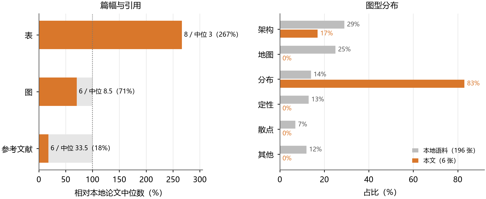

# 27 与遥感顶刊的差距：从 424 篇本地论文里量出来

> 人工逐张调图太慢，先量差距。
> 数据：本地 424 篇全文（自动化学报 224、测绘学报 200）+ 196 张已标图 + 本文稿。
> 说明：自动化学报偏控制/智能，测绘学报偏测绘/遥感；不是 RSE/ISPRS/TGRS 的原刊样本，
> 但篇幅、图表、参考文献的结构规范可比。

---

## 1 硬指标：我们 vs 本地中位数

| 指标 | 自动化学报（224） | 测绘学报（200） | 本文 | 判断 |
|---|---|---|---|---|
| 汉字数 | 9,918 | 7,904 | **10,367** | 在区间内，偏长 |
| 图 | 9 | 8 | **6** | 少 2—3 张 |
| 表 | 3 | 3 | **8** | **多 5 张**，正文被表占满 |
| 参考文献 | 35 | 32 | **6** | **少 5 倍，硬伤** |
| 摘要汉字 | 292 | 298 | **415** | 超 40% |

三条结论：

1. **参考文献是最大硬伤**。6 条不可能支撑“相关工作/方法对比/讨论”，编辑第一眼就会退。
2. **表太多、图太少**。顶刊正文通常 2—3 张表，其余进附录；图 8—10 张承载论证。
3. **摘要偏长**。中文刊摘要 300 字左右，本文 415 字，需要压。

---

## 2 图型结构：我们 83% 是分布图

196 张已标图的类型分布，与本文 6 张图对比：

| 图型 | 本地语料 | 本文 | 差距 |
|---|---|---|---|
| 架构/框架 | 29% | 17%（1 张） | 少，且只有 1 张 |
| 地图 | 25% | **0%** | **完全没有** |
| 分布 | 14% | **83%**（5 张） | **严重偏科** |
| 定性结果 | 13% | **0%** | **完全没有** |
| 散点 | 7% | 0% | 少 |
| 其他 | 12% | 0% | — |

读法：

- 顶刊的图不是“数据图越多越好”，而是**架构图讲方法、地图讲场景、定性图讲效果、分布图讲统计**；
- 本文 5 张分布图，只回答了“数字是多少”，没有回答“方法长什么样”“错在哪”“在场景里什么效果”；
- 地图和定性图缺失，是遥感论文最容易被挑的点。

---

## 3 七个结构性差距

### G1 参考文献与相关工作（致命）

- 6 条 vs 中位 33.5 条；
- 没有独立“相关工作”节；
- 没有与 SOTA 的方法对比表。

### G2 没有研究区/数据覆盖图

- 遥感论文第一张图通常是研究区、航线、瓦片分布；
- 本文只有文字和表 2，读者无法建立空间感；
- 没有坐标/底图时，至少应画“航线—瓦片—日期”的关系示意图。

### G3 没有定性结果图

- 顶刊会用 3—4 个场景的分类图/误差图证明“不是只靠数字”；
- 本文没有任何分类结果可视化；
- 若数据不能公开，可画“示意图 + 误差类型”，但必须标明是示意。

### G4 正文表太多

- 8 张表 vs 中位 3 张；
- 表 3（2×2 读数）、表 4（成员池）、表 5（AUC）、表 8（复现清单）都可移附录或改成图；
- 正文只留：数据口径、SOTA 对比、消融。

### G5 单数据集、无 SOTA、无显著性

- 只有一次竞赛、一个隐藏测试集；
- 没有重训基线、没有置信区间/显著性检验；
- 这是“工程复盘”与“研究论文”的分界线，不是画图能补的。

### G6 图型偏基础

- 柱状/横条/折线为主；
- 没有多面板地图、定性网格、成员池架构、双尺度放大；
- 读者看不出“方法的结构”。

### G7 摘要与叙述偏长

- 摘要 415 字，方法细节过多；
- 正文 10.4k 字，但参考文献只有 6 条，比例失衡。

---

## 4 顶刊图型蓝图（8 张图）

| 图 | 角色 | 图型 | 数据要求 | 能否自动生成 |
|---|---|---|---|---|
| F1 | 研究区/数据覆盖 | 地图 + 航线/瓦片 inset | 坐标或瓦片索引 | 有坐标可自动；否则示意图 |
| F2 | 方法框架 | 三层架构图 | 无 | **可自动（已完成）** |
| F3 | 数据诊断 | 构成 + 漏斗 + 代理尺斜率 | 计数 | **可自动** |
| F4 | 表示与成员池 | 双表示链 + 17 成员架构 | 成员清单 | **可自动** |
| F5 | 定性结果 | 3—4 场景分类图 + 误差图 | 分类栅格 | 需作者提供 |
| F6 | 定量对比 | SOTA 点图/区间图 | 重训基线 | 需实验 |
| F7 | 消融 | 瀑布 + 噪声带 | 已有增量 | **可自动** |
| F8 | 开集 | AUC + 配额曲线 | 已有 | **可自动** |

**能自动的 5 张**（F2/F3/F4/F7/F8），**必须作者补的 3 张**（F1/F5/F6）。
这就是“人工迭代慢”的解法：先把能自动的做满，再把不能自动的列成资产清单。

---

## 5 表的重排

| 表 | 去留 | 理由 |
|---|---|---|
| 表1 任务口径 | 正文 | 必需 |
| 表2 日期不均衡 | 附录 | 与 F3 重叠 |
| 表3 2×2 读数 | 删/并入正文 | 只有 3 行 |
| 表4 成员池 | 附录 | 由 F4 替代 |
| 表5 AUC | 删 | 由 F8 替代 |
| 表6 三条命题 | 正文 | 核心贡献 |
| 表7 最终结果 | 正文 | 必需 |
| 表8 复现清单 | 附录 | 非论证主体 |

正文表从 8 张压到 3 张：任务口径、命题、最终结果。

---

## 6 自动化路线

### 已做

- `tools/paper_gap.py`：统计 424 篇的篇幅/图/表/参考文献，输出 `checks/corpus_gap.json`；
- `tools/make_gap_fig.py`：差距仪表盘；
- `tools/make_framework_fig.py`：三层框架图；
- `tools/make_dual_figs.py`：数据/证据/归因图。

### 待做

1. **`figure_plan.py`**：读 manuscript 的节标题与图注，按“节角色 → 必需图型”输出缺口清单；
2. **`figure_audit.py`**：用图注关键词给本文图分类，和 196 张语料的类型分布对比；
3. **`ref_expand.py`**：按主张从 Crossref/OpenAlex 检索真实文献，生成候选并人工确认，不编造；
4. **`table_trim.py`**：正文表 >3 时自动建议移附录。

### 不能自动的

- 研究区地图：需要坐标/底图；
- 定性结果：需要分类栅格；
- SOTA 对比：需要重训基线；
- 相关工作：需要真实文献与作者判断。

---

## 7 一句话

**我们和顶刊的差距，不是“图不好看”，是“图型结构不对 + 参考文献太少 + 正文表太多”。
先把能自动的 5 张图做满，再把 F1/F5/F6 列成作者资产清单，比继续手调柱状图有效。**
